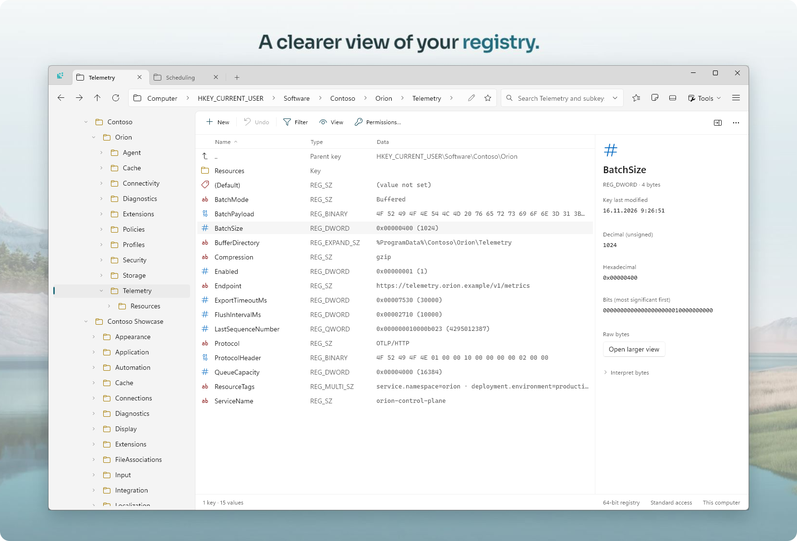

<div align="center">


<h1 align="center">Modern Registry Editor</h1>

</div>

Browse, edit, and investigate the Windows registry in a native app with tabs, familiar Explorer-style navigation, and tools for understanding changes.

<div align="center">

[Project website](https://registryeditor.jiripolasek.com/)

</div>


<div align="center">

</div>

## Features

- **Tabbed navigation:** Reorder and duplicate registry tabs, reopen closed tabs, and restore saved sessions. Navigate with breadcrumbs, address suggestions, and independent back/forward history. Paste standard registry paths, PowerShell paths, or `.reg` headers, and jump between matching local HKCU and HKLM paths.
- **Flexible browsing:** Browse a lazy-loading registry tree and a sortable, filterable list of keys and values. Resize, reorder, and choose columns, including key last-modified times and link targets; switch between combined and values-only lists and follow supported registry links.
- **Registry editing:** Create, copy, delete, and rename keys and values, including inline rename in the list. Duplicate a value under a new name while preserving its type and exact bytes. Edit strings, multi-strings, DWORD/QWORD numbers, and raw bytes with a hex and ASCII editor, including uncommon registry types.
- **Undo and redo:** Undo or redo committed registry edits with per-tab history and Ctrl+Z / Ctrl+Y. Conflict checks protect later changes, and blocked actions link to the journal for review.
- **Search:** Use Find Next or progressively populated result tabs in the bottom panel. Filter by value type, cancel a scan while keeping its matches, and save searches for later.
- **Web search:** Look up a key path or value name in your default browser using Bing, Google, DuckDuckGo, or a custom search URL. Searches exclude value data and remote computer names.
- **Value inspector:** Keep a resizable inspector beside or below the registry list as you select values. Read full text and interpret bytes as numbers, text, GUIDs, or timestamps. Reveal supported local file paths in File Explorer.
- **Snapshots and change journal:** Compare branch snapshots, export selected differences, and review persistent before-and-after records of app edits. Revert recorded edits with conflict checks and archive entries from the journal view.
- **Live watches:** Watch local keys or individual values and inspect timestamped before-and-after data. Pause viewing while capture continues, follow the latest changes, or stop and restart a watch.
- **Script export:** Copy selected snapshot differences, journal entries, or watch observations as PowerShell or `reg.exe` scripts for review and reuse.
- **Favorites, notes, and workspaces:** Organize favorites into folders, attach automatically saved notes to keys, and save named workspaces containing registry tabs, searches, and watch definitions.
- **Files and reports:** Import and export `.reg` files, export the entire registry, save/load/unload native hives, and print a key, branch, or the entire registry.
- **Windows integration:** Switch between 32-bit and 64-bit registry views, edit permissions in native Windows dialogs, and open a location as administrator. Use `regedit2://` links and taskbar Jump List shortcuts for windows and favorites. Remote registry connections are available as a preview.
- **Fluent interface:** Choose system, light, or dark appearance with Mica or Acrylic backdrops. Customize toolbar buttons, data fonts, list spacing, and the status bar; use tools in tabs, the right sidebar, or the resizable bottom panel.

See the [user guide](docs/user/Guide.md) for workflows and keyboard shortcuts, or the [changelog](CHANGELOG.md) for project changes.

## Installation

Registry Editor currently runs from a source build. There is no installer or `.reg` file association setup. The app bundles the Windows App SDK runtime and requires the .NET 10 runtime.

See [Development](docs/dev/readme.md) to build and run it locally.

## Usage

Open a registry location with the address bar, or pass a path to the executable:

```powershell
.\regedit2.exe 'HKCU\Software\Microsoft'
.\regedit2.exe 'HKLM\SOFTWARE' --32
```

After the first launch, `regedit2://` links can open local registry locations. See [paths and links](docs/user/Guide.md#open-a-registry-path-or-link) for syntax and remote connections.

Registry edits apply immediately. See [data and permissions](docs/user/Guide.md#data-and-permissions) for backup, import, and recovery behavior.

## Development

[Development guide](docs/dev/readme.md)

## Licence

[Apache License 2.0](LICENSE.txt)

## Author

[Jiří Polášek](https://jiripolasek.com)
